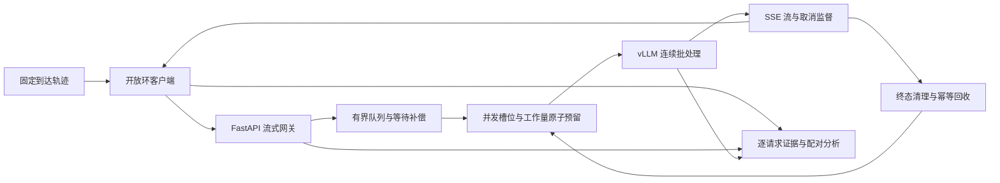
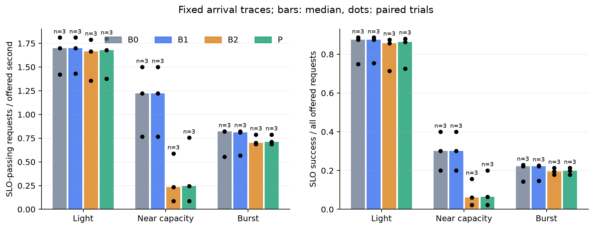

# vLLM Admission Lab

**面向 LLM 推理服务的流式准入网关与可复现 SLO 评测。**

Python · AsyncIO · FastAPI · vLLM · Kubernetes · Open-loop Benchmark

实现请求治理，并用真实 GPU 实验回答一个具体问题：在 vLLM 外部加入工作量预算与成本排序，能否提高混合长短请求的 SLO goodput？

**实测答案：本轮配置下不能。** 近容量主负载中，自定义策略相对原生 FCFS 的种子内配对 goodput 相对变化中位数为 **−68.12%**。本项目的成果是完整的请求生命周期实现、可复算的实验，以及对服务退化的诊断。推荐保留原生 FCFS。

## 已完成

| 内容 | 可核验成果 |
|---|---|
| 流式网关 | 并发/工作量双预算、原子预留、有界队列、FCFS/成本等待补偿、最老请求保护 |
| 生命周期 | SSE 代理、断连与显式取消监督、终态清理、幂等回收、结构化事件 |
| 功能验证 | 23 项 CPU/模拟后端及本地 HTTP 测试；真实 GPU 取消另行验证 |
| GPU 实验 | 单张 RTX 5090，36 组主实验 + 4 组同设备新轨迹验证 |
| 数据 | 11,560 次计划请求，11,559 成功、1 次读取失败；失败保留在分母 |
| 计量 | 固定轨迹开放环回放、同设备同种子配对、TTFT/E2E SLO、发送落后与排空检查 |
| 取消观测 | 隔离探针中，关闭后约 58 ms 观察到预算清零，约 0.62 s 观察到引擎空闲 |

取消时间是单次隔离验证观测，不是生产 SLA。没有修改 vLLM/CUDA 内核；没有实现多机调度或分布式高可用。

## 架构



四组对照：**B0** 原生 FCFS；**B1** 开发集选择的原生容量配置；**B2** 同预算网关 FCFS；**P** 成本/等待补偿网关。开发集最终选中的 B1 仍是 FCFS，不能称为 Priority 优化。

成本为 `c + a × input_tokens + b × output_budget`；排序值为 `cost / (1 + waiting_ms / tau_ms)`。预算完整预留到请求终态。最老请求超过阈值后等待容量排空，保护下一次准入机会；持续过载仍可能超时。

## 实测结果

实验日期：2026-11-18。Qwen2.5-7B-Instruct、BF16、TP=1、RTX 5090 32,607 MiB；vLLM 0.33.0、Torch 2.14.0/CUDA 13.0、Python 3.12.16。所有策略在同一设备顺序运行。

| 负载 | B0 | B1 | B2 | P |
|---|---:|---:|---:|---:|
| light | 1.7000 | 1.7000 | 1.6667 | 1.6778 |
| near_capacity | 1.2222 | 1.2222 | 0.2333 | 0.2444 |
| burst | 0.8222 | 0.8111 | 0.7000 | 0.7111 |

单位：达标请求 / 到达秒；每格为 3 个种子的 cohort goodput 中位数。cohort goodput 的分母是 90 秒到达窗口，wall goodput 另计尾部排空；不能将它解释为稳态最大吞吐。



P/B0 种子内配对相对变化中位数：light **−1.31%**、near_capacity **−68.12%**、burst **−4.05%**。这些是先配对再取中位数，不等于上表两列中位数之比。

新轨迹验证只有 1 个种子：P/B2 **+38.24%**，但 P/B0 **−58.22%**。不能将相对较弱网关基线的局部收益写成 vLLM 加速。

低负载成本拟合的留出中位 APE 为 **0.5525%**，但低负载单请求延迟不等于连续批处理下可相加的资源消耗。近容量监控中，原生引擎 running 样本均值约 24–35，网关约 14，同时外部队列积累。这与准入预算减少批处理机会的解释相容；尚无消融将预算、排空保护和代理开销分别隔离。

详见 [完整报告](reports/RTX5090-最终报告.zh-CN.md)、[实验设计](EXPERIMENT_PLAN.zh-CN.md)、[简历与面试](docs/RESUME.zh-CN.md)。只有 3 个主种子、1 张卡、合成负载，结果为描述性比较。

## 无 GPU 核验：约几分钟

在仓库根目录执行，Python 3.10+：

```bash
python -m venv .venv
# Linux/macOS
source .venv/bin/activate
# Windows PowerShell 使用 .venv\Scripts\Activate.ps1
python -m pip install -e ".[test]"
python -m pytest -q
python scripts/verify_public.py
```

`verify_public.py` 检查公开文件哈希、40 组请求守恒与轨迹哈希，从逐请求记录重新计算指标和种子内配对效应，并与已发布结果比较。它不需要 GPU 或模型权重，也不替代原始 GPU 实验复跑。

重新生成图表与统计表（写入独立目录）：

```bash
python -m bench.analyze --root artifacts/formal --output reproduced/main --require-complete
python -m bench.analyze --root artifacts/validation --frozen configs/validation.yaml --output reproduced/validation --require-complete
```

## 使用真实 vLLM 后端

以下是 Linux GPU 环境中的功能演示。先安装与硬件匹配的 vLLM；本轮精确依赖记录见 [依赖快照](artifacts/requirements.remote.lock.txt)。安装快照不保证任意设备可直接运行。

```bash
export VLLM_USE_FLASHINFER_SAMPLER=0
vllm serve /models/Qwen2.5-7B-Instruct \
  --served-model-name admission-7b --host 127.0.0.1 --port 8000 \
  --dtype bfloat16 --tensor-parallel-size 1 --max-model-len 16384 \
  --max-num-seqs 64 --max-num-batched-tokens 8192 \
  --gpu-memory-utilization 0.85 --enable-chunked-prefill \
  --disable-prefix-caching --enable-request-id-headers
```

另开终端启动单 worker 网关：

```bash
export ADMISSION_CONFIG=configs/gateway.demo.yaml
python -m uvicorn admission_lab.app:create_app --factory --host 127.0.0.1 --port 8080 --workers 1
curl http://127.0.0.1:8080/health
```

接口接受单条 token-ID prompt、`n=1`、流式 `/v1/completions`。演示配置默认未验证取消路径，先按 [复现说明](docs/REPRODUCE.zh-CN.md) 完成真实后端取消验证。网关是研究原型，调度状态保存在进程内。

## 仓库导航

| 目录 | 内容 |
|---|---|
| `src/admission_lab/` | 网关、调度器、SSE 解析与遥测 |
| `bench/` | 回放、开发选择、矩阵运行、取消探针、分析 |
| `tests/` | 资源守恒、生命周期、HTTP 集成、恢复边界测试 |
| `configs/` | 保留技术参数的公开配置；GPU 标识与集群路径为占位符 |
| `artifacts/formal/`、`artifacts/validation/` | 全部逐请求记录、运行清单、网关事件、精简监控 |
| `reports/` | 统计结果、图表、完整中文报告 |
| `PUBLIC_EXPORT.json` | 原文件与公开副本的哈希映射、导出变换说明 |

公开版保留实验参数和全部请求计量；服务器凭据、访问地址、内部节点名与设备标识已移除或使用稳定别名。原始冻结归档独立保留。清单中的原始来源哈希不代表脱敏后的文件仍与原件相同，详见 [数据与来源边界](docs/DATA_PROVENANCE.zh-CN.md)。
