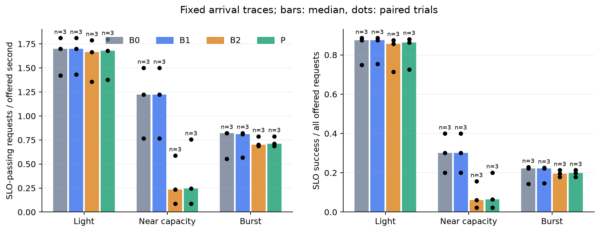
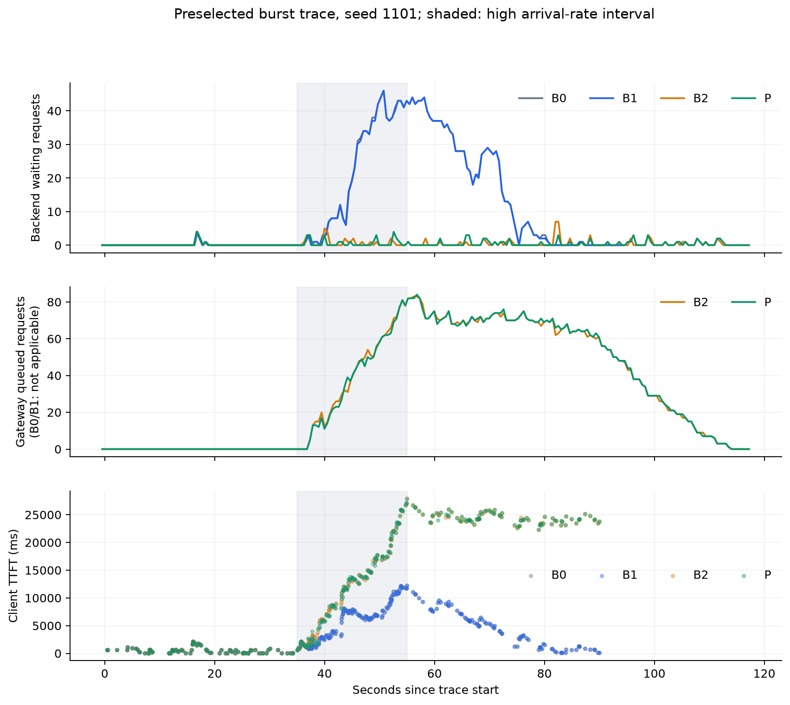

# RTX 5090 推理准入与 SLO 评测：最终报告

2026-11-18。五个阶段已依次执行：Kubernetes 资源分配、GPU 运行时与模型冒烟、重新标定与开发选择、完整性能矩阵与新轨迹验证、结果复核与交付。

**36 组主实验和 4 组验证全部完成且有效，共 11,560 次计划请求；11,559 次成功完成，1 次客户端连接读取失败。23 项测试通过。** 失败请求保留在指标分母中，没有重试或剔除。单组发送落后 P95 的最大值为 6.884ms，低于预先声明的 20ms 失效阈值。

本轮没有证据支持自定义网关优于原生引擎。近容量主负载中，P 相对 B0 的三个种子全部下降，配对相对变化中位数为 **-68.12%**。项目的可展示价值是完整的准入、取消和流式生命周期实现，以及能保留负面结果的可复核评测。

## 1. 实现与运行条件

网关采用 `c + a×输入token + b×输出预算` 的成本估计，同时预留并发槽位与完整请求成本，在终态清理后幂等回收。队列支持 FCFS，以及 `cost / (1 + waiting_ms / tau_ms)` 的成本/等待补偿排序。最老请求超过阈值时等待容量排空，保护其下一次准入机会；过载下仍可能超时，不承诺任意负载下有限等待。

实现包括流式 SSE 代理、显式与断连取消监督、有界队列、终态清理、开放环回放、固定轨迹、计量校验、源码/模型/环境溯源。当前接口限于单条 token-ID prompt、`n=1`、流式 completions；单 worker 的内存调度状态不提供分布式高可用。

| 项目 | 实际设置 |
|---|---|
| 资源 | 实验命名空间申请 1 张 RTX 5090，报告总显存 32,607MiB |
| 设备 | GPU-PUBLIC-DEVICE-0，驱动580.142 |
| 资源约束 | CPU请求4核/上限8核，内存请求20GiB/上限48GiB |
| 软件 | Python3.12.16、vLLM0.33.0、Torch2.14.0/CUDA13.0 |
| 模型 | Qwen2.5-7B-Instruct，BF16、TP=1，14个文件逐一SHA256 |
| 共同参数 | 最大长度16384、max-num-seqs64、批token上限8192、GPU memory utilization=0.85 |
| 缓存与采样 | 关闭前缀缓存、开启分块预填充；统一使用VLLM_USE_FLASHINFER_SAMPLER=0 |
| 顺序 | 所有策略、三个主种子及验证均在同一获分配GPU上顺序运行 |

最初 runtime 镜像缺少C编译器；devel镜像拉取耗时较长，最终在缓存镜像的容器启动阶段安装Ubuntu GCC11工具链，再以UID1001运行实验。应用使用虚拟环境中的CUDA13编译工具，不使用基底镜像的CUDA12.8 NVCC。没有修改宿主机软件、模型权重或其他服务。

GPU实际矩阵运算、单设备可见性、真实512/128 token生成均验证通过。CPU/模拟后端测试与真实GPU验证分开记录，23项测试不等于23组GPU性能测试。

## 2. 独立开发与冻结规则

开发种子为2201，主实验种子1101/1102/1103，验证种子4401。12次单请求观测拟合成本，4次留出观测检查未参与拟合的长度组合。

拟合系数为 `c=0.01`、`a=0.0798124 ms/input-token`、`b=9.7604445 ms/output-token`。留出中位绝对百分比误差为 **0.5525%**。这只是固定模型少量低负载观测的延迟近似，不能解释为高并发可加资源需求的预测精度。

参考速率按预先声明的短探测规则选为4 req/s。light=2 req/s；near_capacity=3.8 req/s；burst平时2.4 req/s、35–55秒为8 req/s。它不是测得的物理最大吞吐；有限Poisson轨迹的实际请求数量会波动。

| 类别 | 生成占比 | 输入/输出token | TTFT/E2E SLO |
|---|---:|---:|---:|
| S：短请求 | 60% | 512/128 | 500/5000ms |
| P：长预填充 | 25% | 8192/128 | 2000/8000ms |
| D：长解码 | 15% | 512/512 | 500/15000ms |

SLO取预先声明下限与低负载P95两倍的最大值，本轮等于上述下限；客户端期限60秒。失败、超时、拒绝和断流均保留分母。每组90秒到达窗口，随后计量到所有请求终态并核验排空。

网关四候选与原生四候选在同一开发轨迹比较。选中网关K=64、预算45,209.446ms、tau=250ms、最老请求保护阈值2000ms，开发goodput=0.45 req/s。原生选中 **FCFS**、active64、queued272、queued tokens524288，开发goodput=1.3 req/s；Priority候选未胜出。

配置、SLO、参考速率和源码在正式矩阵前冻结；正式结果没有用于改选或调参。后端组间按种子交替先后顺序，组内任务固定种子打乱，前后检查空闲。此设计仍保留组与时间的绑定，不能消除全部漂移。

## 3. 主矩阵结果

B0为原生FCFS；B1为开发集选中的原生容量配置；B2为与P同预算的网关FCFS；P为成本/等待补偿网关。**本轮B1同样是FCFS，不能把它称为Priority收益。**

`cohort_goodput` 是本批请求最终同时满足TTFT和E2E SLO的数量除以90秒到达窗口；它不是稳态最大吞吐。`wall_goodput` 另包含尾部排空，逐组数据同时保存。

| 负载 | B0 goodput中位数 | B1 | B2 | P |
|---|---:|---:|---:|---:|
| light | 1.7000 | 1.7000 | 1.6667 | 1.6778 |
| near_capacity | 1.2222 | 1.2222 | 0.2333 | 0.2444 |
| burst | 0.8222 | 0.8111 | 0.7000 | 0.7111 |

单位为达标请求/到达秒，各格均为3组。效应计算先在相同种子内配对，再对差值或相对变化取中位数，不能用上表两列中位数相除代替配对效应。

| 配对对比 | light相对变化中位数 | near_capacity | burst |
|---|---:|---:|---:|
| B1/B0 | 0.00% | 0.00% | 0.00% |
| P/B2 | +0.67% | +4.76% | 0.00% |
| P/B0 | -1.31% | -68.12% | -4.05% |

各比较n=3，均为描述性结果。B1相对B0未观察到稳定SLO goodput增益。P相对同预算B2的轻微变化不能写成相对原生vLLM的加速。

近容量P/B0的完整配对是：

| 种子 | B0 goodput | P goodput | 相对变化 |
|---|---:|---:|---:|
| 1101 | 1.5000 | 0.7556 | -49.63% |
| 1102 | 1.2222 | 0.0889 | -92.73% |
| 1103 | 0.7667 | 0.2444 | -68.12% |

主矩阵共10,320次请求。B0-burst-1102中1次长预填充请求发生`client_ReadError`，没有收到HTTP响应；其余346次完成，该组发送时序、请求守恒和排空仍有效。该请求没有重试，并保留在失败和SLO分母内。其余主矩阵请求全部成功完成。

## 4. 独立轨迹验证

主矩阵全部结束后，在同一设备顺序运行新种子4401的4组近容量轨迹，每组310次请求，共1240次，全部成功完成。这是新到达轨迹验证，不是第四张GPU、跨硬件或生产流量验证。

| 条件 | SLO达标/计划 | cohort goodput | wall goodput | 成功请求TTFT P95 |
|---|---:|---:|---:|---:|
| B0 | 225/310 | 2.5000 | 2.3410 | 1933.69ms |
| B1 | 225/310 | 2.5000 | 2.3413 | 1943.08ms |
| B2 | 68/310 | 0.7556 | 0.7075 | 4950.38ms |
| P | 94/310 | 1.0444 | 0.9780 | 4793.25ms |

该单种子中P比B2多26次达标，goodput相对增加38.24%；相对B0仍下降58.22%。因此不能把这38.24%当作网关相对原生引擎的性能收益，也不能把单轨迹结果扩大为稳定提升。

## 5. 为什么低负载成本拟合准确，系统仍变慢

输入/输出成本模型近似的是低负载单请求完成时间。连续批处理下，多个请求共享服务过程，将完整估计时间相加并一直预留到终态，不等价于引擎真实可加资源消耗。

0–90秒监控样本显示，外部网关明显降低了引擎同时运行请求数，并把等待留在外部。以下为样本均值，不是精确时间积分：

| 种子 | B0引擎running样本均值 | B2 | P | P外部队列峰值 |
|---|---:|---:|---:|---:|
| 1101 | 24.27 | 14.51 | 14.88 | 42 |
| 1102 | 29.87 | 14.49 | 14.35 | 70 |
| 1103 | 35.03 | 13.72 | 13.87 | 81 |

这些观测与准入预算压低批处理机会的解释相容。P/B2共享预算，近容量中位差仅0.0111 req/s，说明排序上的局部收益未能弥补共同准入约束的代价。不过，本轮没有分离预算、老请求排空保护和额外代理开销，不能把所有下降确定归因于单个机制。

网关内引擎waiting接近零不能说明系统拥塞改善：外部队列仍在累积，客户端等待明显增长。成功请求延迟与失败比例同时展示，避免用更少的引擎队列掩盖端到端代价。

## 6. 生命周期、数据和验收

修正后的原生取消探针在关闭前观察到引擎运行，关闭后约0.556秒观察到空闲。真实网关探针在关闭前同时观察到运行请求与预算预留，关闭后约 **58ms** 观察到预算清零、约 **0.616秒** 观察到引擎空闲，之后经网关的有效请求成功。它们是隔离状态观测，不是生产取消延迟SLA或任意故障下的严格终止证明。

探针初版曾因临时流迭代器提前析构而提前关闭连接；轨迹生成也曾因旧相对模型路径失败。两次问题均在正式矩阵前处理，原失败日志、状态和早期探针记录保留，没有用重做的数据覆盖失败证据。调度策略和开发选择未因此修改。

最终审计重新核验40组请求数量、唯一ID、轨迹内容与哈希、输入/输出token、DONE/finish reason、GPU归属、模型/环境/配置/来源清单、网关终态及后端排空；14个模型文件重新计算SHA256，全部一致。冻结文件未变，GPU服务进程已停止，获分配设备显存占用0MiB。

证据见 `all_results.json`、`paired_comparisons.json`、`monitoring_summary.json`、`validation/` 和 `../artifacts/final_evidence_audit.json`。冻结归档保留当时的少量生成缓存快照，完整Python环境、模型权重和SSH凭据不打包。资源释放回执另存，避免把退出进程和释放Kubernetes分配混为一项。

## 7. 结论与使用建议

本轮默认建议保留原生FCFS。在该固定模型和合成负载下，所选原生容量限制没有稳定改变SLO goodput，自定义静态成本预算网关在近容量负载明显更差。

网关仍可展示有界准入、流式生命周期、取消清理和请求治理的工程实现。性能方向的下一步应作为新实验，重新设计资源预算或反馈机制，并用原生能力作对照，不能把本轮负面结果包装为加速。

三种子、单设备、单主机、共享CPU及组间时间绑定限制外推；请求共享队列，不是11,560个独立统计重复。本报告不声称统计显著、生产服务保证或跨硬件加速。旧PRO6000的26组阶段结果独立保留，未混入本轮40组。
