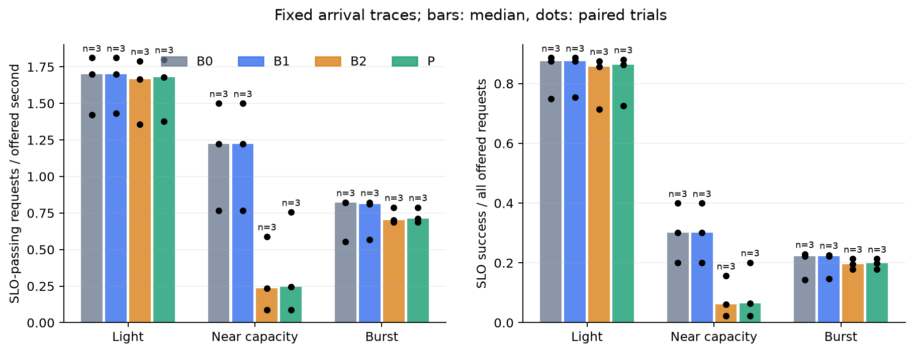

# RTX 5090 工作量准入与公平排队实测报告

主矩阵 36 组、验证 4 组均完成且有效，共 11,560 次计划请求，其中未成功完成 1 次，保留在分母中。

环境：Python / vLLM 0.33.0 / Torch 2.14.0，CUDA 13.0。模型 Qwen2.5-7B-Instruct BF16；一个通过 实验命名空间分配的 RTX 5090，TP=1，全部条件顺序运行。

测试 23 项通过。真实取消探针 verified=True，关闭连接后 0.5559 秒观察到引擎空闲。

独立真实网关断连检查通过：预留预算在 0.0580 秒内观察到清零，后端在 0.6163 秒内观察到空闲；之后经网关的有效请求成功。该检查不参与性能矩阵指标。

成本模型四次低负载留出观测的中位绝对百分比误差 0.5525%；不将它扩大解释为高并发资源需求预测精度。

## 主矩阵配对效应

先在同一种子、同一 GPU、同一轨迹内求差值，再求中位数。n 是种子级配对数量；不给出请求级独立样本显著性结论。

| 候选 / 基线 | 负载 | n | goodput 差值中位数 req/s | 配对相对变化中位数 |
|---|---|---:|---:|---:|
| B1 / B0 | light | 3 | +0.0000 | +0.00% |
| B1 / B0 | near_capacity | 3 | +0.0000 | +0.00% |
| B1 / B0 | burst | 3 | +0.0000 | +0.00% |
| B2 / B0 | light | 3 | -0.0333 | -1.96% |
| B2 / B0 | near_capacity | 3 | -0.9111 | -69.57% |
| B2 / B0 | burst | 3 | -0.0333 | -4.05% |
| P / B2 | light | 3 | +0.0111 | +0.67% |
| P / B2 | near_capacity | 3 | +0.0111 | +4.76% |
| P / B2 | burst | 3 | +0.0000 | +0.00% |
| P / B0 | light | 3 | -0.0222 | -1.31% |
| P / B0 | near_capacity | 3 | -0.7444 | -68.12% |
| P / B0 | burst | 3 | -0.0333 | -4.05% |

## 独立轨迹验证

使用种子4401、同一 GPU 在主矩阵结束后顺序执行，仅为新到达轨迹验证，不是跨设备或第四张卡验证。

| 条件 | 计划请求 | SLO 达标 | cohort goodput req/s | 失败比例 | 成功请求 TTFT P95 ms |
|---|---:|---:|---:|---:|---:|
| B0 | 310 | 225 | 2.5000 | 0.00% | 1933.69 |
| B1 | 310 | 225 | 2.5000 | 0.00% | 1943.08 |
| B2 | 310 | 68 | 0.7556 | 0.00% | 4950.38 |
| P | 310 | 94 | 1.0444 | 0.00% | 4793.25 |

## 如何解释

B0=原生FCFS；B1=开发集选中的原生配置；B2=同预算网关FCFS；P=成本排序、等待补偿及最老请求保护。B1/B0和P/B2回答不同问题，不能把相对网关FCFS的收益写成相对原生vLLM的收益。

cohort goodput 是固定到达窗口内这批请求最终同时满足 TTFT/E2E SLO 的数量除以到达窗口，不是稳态最大吞吐。wall goodput 包含尾部排空；失败和超时始终保留分母。

全局 SLO 达标数量改善可能伴随长解码请求尾延迟恶化。请同时查看各类别、失败比例和每个种子的效应，不能只挑选一个正向百分比。

三种子、单设备、单主机和共享 CPU 是解释边界。后端组内随机次序、组间交替及空闲检查减少部分漂移和串扰，不能消除所有时间影响。不声称统计显著、生产保证或跨硬件加速。

旧 PRO 6000 的26组阶段结果独立保留，未用于凑齐本轮矩阵，也不作跨硬件配对。

## 证据入口

逐请求记录见 artifacts/formal 和 artifacts/validation；冻结配置与源码、模型和环境溯源见各 provenance。运行完整性见 completeness.json，具体效应见 paired_comparisons.json，失败与类别明细见 all_results.json。
